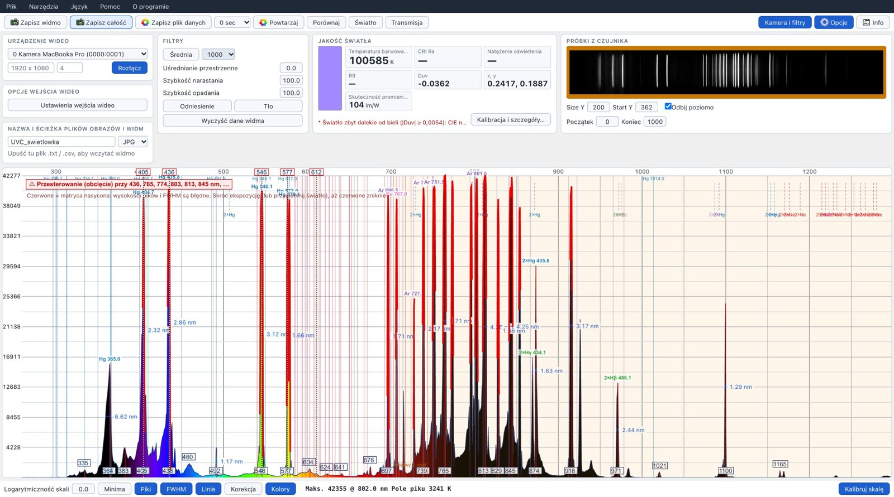
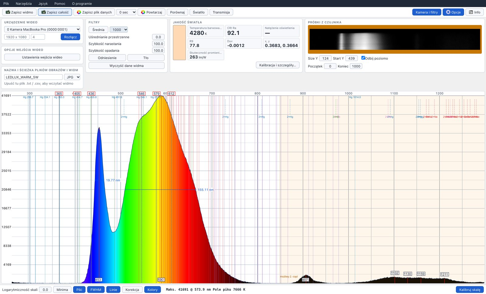
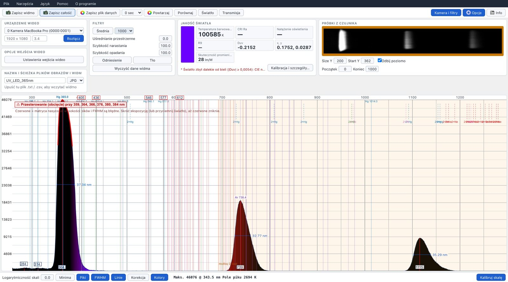

# WebSpectrometer2.0

**English** | [Polski](docs/README.pl.md)

**Browser-based software for DIY and webcam spectrometers** – live spectrum, wavelength and spectral-response calibration, light quality (CCT, CRI, R9), UV analysis, transmission and absorbance – all running locally in your browser.

**▶ Open the app: [radoslawo81.github.io/WebSpectrometer2.0](https://radoslawo81.github.io/WebSpectrometer2.0/)** · [Releases (offline package)](https://github.com/radoslawo81/WebSpectrometer2.0/releases) · [Changelog](CHANGELOG.md)

No installation: open it in a Chromium-based browser (Chrome, Edge, Opera, Brave…), connect the spectrometer camera and measure. 🔒 All image processing happens on your computer – no video or spectrum data is ever uploaded.



*Germicidal (UVC) mercury lamp measured with a Little Garden spectrometer: Hg 365 / 405 / 436 / 546 / 577 nm and the argon lines in the near infrared are identified automatically, 2nd-order images of the mercury lines are marked.*

## Features

**Acquisition and calibration**
- Any UVC webcam spectrometer (e.g. Little Garden Spectrometer, DIY webcam + grating builds); TCD1304 / TCD1254 linear sensors over Web Serial
- Filtering: frame averaging, rise/fall speed, spatial averaging, reference and background (dark frame)
- Wavelength calibration: manual multi-point (Trim points) or **automatic** from a reference lamp – CFL, UVC Hg/Ar, neon, sodium, hydrogen, helium, sunlight (Fraunhofer lines)
- **Spectral response calibration** – removes the camera/grating sensitivity bumps. Sources: incandescent bulb (≈2700 K), halogen 230 V (≈2900 K), halogen 12 V (≈3000 K), CIE illuminant A, custom temperature, or a **reference spectrum file** (e.g. a ground-level solar spectrum, with the O₂/H₂O bands skipped)
- Saturation warning: clipped parts of the spectrum are drawn red; calibration is refused on a clipped spectrum

**Analysis**
- Peaks and dips with labels, **FWHM**, logarithmic scale, zoom/pan, wavelength-true colours
- **Spectral line identification** (Hg, Ar, Ne, Na, H, He, CFL phosphors, Fraunhofer lines); broad LED peaks are not mistaken for atomic lines
- **Higher diffraction orders**: peaks at 2λ / 3λ of a shorter-wavelength peak are flagged as 2nd / 3rd-order ghosts (each order can be switched off)
- **Band bar** under the graph: UVC, UVB, UVA, blue, green, yellow, orange, red, IR
- **Compare** two spectra: total and per-band (UV / B / G / R / IR) change, shape difference
- **HDR**: merge a short and a long exposure
- **Time log**: intensity, band, peak position, CCT, lux over time

**Light quality**
- CCT, Duv, x/y, CRI Ra and R1–R14 (R9), luminous efficacy of radiation, illuminance (lux) after calibration
- CCT and CRI are reported only for white light (|Duv| ≤ 0.05) – coloured, UV and grow lights show “—” instead of meaningless values
- **UV-A share** (340–400 nm)

**Sensors window (*Tools → Sensors*): AS7331 UV + AS7265x 18-channel (SparkFun Spectral Triad)**
- One Web Serial connection, one bar chart 240–960 nm: UVA / UVB / UVC from the AS7331 (covers the UVC and UVB the camera spectrometer cannot see) next to the 18 triad channels 410–940 nm, optionally per nm so both compare
- UV values with min / mean / max and trend; automatic gain, illumination LEDs, CSV logs; readings are stored with saved spectra and in the report
- **Triad channel correction** with a clear incandescent bulb (Planck): fixes the per-channel errors of the factory calibration
- **Live overlay**: the sensor channels as bars over the live camera spectrum in the main graph, scaled to fit the camera curve
- Show the combined spectrum (with or without UV) in the main graph, or use the triad reading as the **reference for the spectral response calibration** of the camera spectrometer (with a halogen or incandescent lamp, or sunlight)

**Sensor firmware**: ready sketch for the LILYGO T-Display-S3 with on-screen readout, for the AS7331 and/or the AS7265x on either I2C connector: [firmware/tdisplay-s3-sensors](firmware/tdisplay-s3-sensors/)

**Samples**
- **Transmission** of glasses, filters and windows: τv, sunglass category, UV / HEV / IR blocking, colour rendering through the lens
- **Absorbance** (cuvette): A(λ), λmax, concentration from Beer–Lambert or a calibration line

**Data**
- CSV/TXT spectra (compatible with Theremino Spectrometer files), images, timed auto-save
- HTML measurement report (print to PDF)
- Interface in English and Polish



*Light quality panel for a 5 W LED bulb: CCT, Duv, CRI Ra and R9 computed live from the spectrum.*

## Quick start

1. Open the app in Chrome or Edge and click **Connect** (allow camera access).
2. Select the spectrometer camera, set **manual** exposure and gain in *Video Input Controls* (button **Camera & filters** shows the panels) (no auto-exposure, no auto white balance).
3. Choose the sensor rows (**Start Y**, **Size Y**) so that the spectrum strip is inside the window.
4. **Wavelength calibration** – point the spectrometer at a fluorescent lamp (or a UVC lamp) and use *Tools → Auto calibration…*, or drag the 436 / 546 nm labels onto the mercury lines.
5. **Spectral response calibration** (for CCT, CRI and true spectrum shapes) – *Light quality → Calibration & details…*: choose the source (e.g. incandescent bulb), click **Calibrate**, then switch on **Corrected** in the status bar.

## Measurement tips

- **Use a diffuser on the slit** (PTFE sheet or opal glass) and a fixed geometry. Without it the spectrum shape changes with the lamp position: LEDs emit the blue pump and the phosphor light at different angles, and the slit sees only a part of the source. Avoid paper and white plastics – optical brighteners fluoresce under UV/blue and add a false peak at 420–450 nm.
- **No red (clipped) regions**: shorten the exposure until the warning disappears; peak heights and FWHM are wrong where the sensor is saturated.
- Let lamps warm up (LEDs a few minutes, fluorescent lamps 10–15 min) and take a dark frame (**Background**) with the lamp off.
- Keep the same exposure, gain and diffuser as during the response calibration.

### Limits of webcam / DVD-grating spectrometers

Measured with a Little Garden Spectrometer (DVD transmission grating, debayered sensor):
- **UV**: signal down to ≈335–345 nm (Hg 334 nm barely visible, 313 and 254 nm not seen); reliable from ≈360 nm. Resolution in the UV is lower (FWHM ≈6.6 nm at 365 nm vs 2.3–2.8 nm at 405–436 nm).
- **Higher orders** are strong in the near IR: a 365 nm UV LED appears again at ≈735 nm (2nd order) and ≈1110 nm (3rd order). Above ≈760 nm results of UV-rich sources are contaminated – the ghost markers show where.
- Silicon sensors see almost nothing above ≈1100 nm.



*365 nm UV LED (overexposed): the same light appears again at ≈739 nm (2nd order) and ≈1115 nm (3rd order).*

## Development

```bash
npm install
npm run dev      # local development server
npm run build    # production build in dist/
```

- **Deployment**: every push to `main` builds the site and publishes it to GitHub Pages (`.github/workflows/pages.yml`).
- **Release**: *Actions → Release → Run workflow*, enter a tag (e.g. `v2.0.0`). The workflow creates the tag, the GitHub release (notes from `.github/release-notes/<tag>.md`) and the offline package.
- **Offline package**: unzip and serve the folder with any static server (browsers do not run it from `file://`), e.g. `python3 -m http.server 8000`, then open http://localhost:8000.
- Stack: React + TypeScript + Vite; no backend.

## History and credits

WebSpectrometer2.0 is an independent continuation of two open projects:
1. **[Theremino Spectrometer](https://www.theremino.com/en/downloads/automation#spectrometer) V5.0** – the original Windows application by Theremino System, published under a “No Copyright” policy;
2. **[jayden-sudo/WebSpectrometer](https://github.com/jayden-sudo/WebSpectrometer)** – its browser port (GNU GPL v3), from which this project was forked and then detached.

The features added in WebSpectrometer2.0 (light quality, response calibration, transmission, absorbance, automatic calibration, line identification, higher-order ghosts, UV analysis, Polish UI and more – see the [changelog](CHANGELOG.md)) were developed with **Claude** (AI by Anthropic), based on the ideas, requirements and measurements of **Radek ([radoslawo81](https://github.com/radoslawo81))**.

This project is not affiliated with Theremino System or with the author of the base web version.

## License

[GNU General Public License v3.0](LICENSE) – the same as the base project. You may use, modify and distribute the software; modified versions must remain under GPL v3 and keep the credits above.
