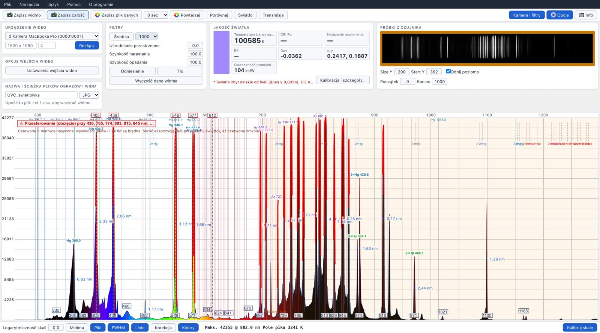
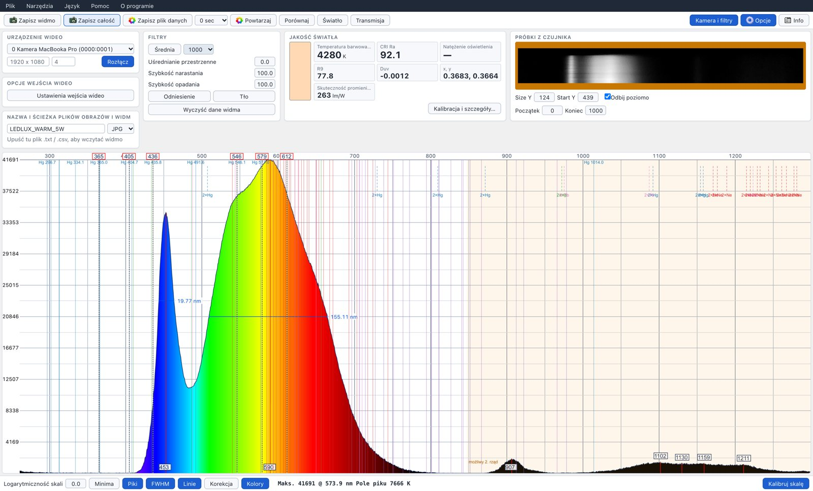
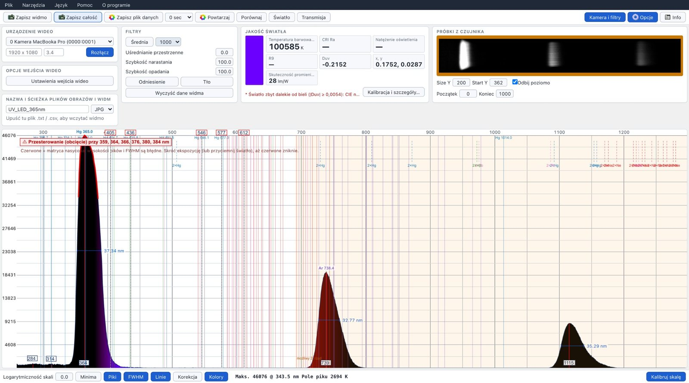

# WebSpectrometer2.0

[English](../README.md) | **Polski**

**Program w przeglądarce do spektrometrów DIY i spektrometrów z kamerą** – widmo na żywo, kalibracja długości fali i czułości, jakość światła (CCT, CRI, R9), analiza UV, transmisja i absorbancja. Wszystko działa lokalnie w przeglądarce.

**▶ Otwórz program: [radoslawo81.github.io/WebSpectrometer2.0](https://radoslawo81.github.io/WebSpectrometer2.0/)** · [Wydania (paczka offline)](https://github.com/radoslawo81/WebSpectrometer2.0/releases) · [Lista zmian](../CHANGELOG.md)

Bez instalacji: otwórz w przeglądarce opartej na Chromium (Chrome, Edge, Opera, Brave…), podłącz kamerę spektrometru i mierz. 🔒 Całe przetwarzanie obrazu odbywa się na Twoim komputerze – żadne nagrania ani widma nie są nigdzie wysyłane.



*Rtęciowa lampa bakteriobójcza (UVC) zmierzona spektrometrem Little Garden: linie Hg 365 / 405 / 436 / 546 / 577 nm i linie argonu w bliskiej podczerwieni rozpoznane automatycznie, obrazy linii rtęci w 2. rzędzie oznaczone.*

## Funkcje

**Akwizycja i kalibracja**
- Dowolny spektrometr z kamerą UVC (np. Little Garden Spectrometer, konstrukcje DIY: kamera + siatka); liniowe czujniki TCD1304 / TCD1254 przez Web Serial
- Filtry: uśrednianie klatek, szybkość narastania/opadania, uśrednianie przestrzenne, odniesienie i tło (ciemna klatka)
- Kalibracja długości fali: ręczna wielopunktowa (punkty kalibracji) lub **automatyczna** z lampy wzorcowej – świetlówka, lampa UVC Hg/Ar, neon, sód, wodór, hel, Słońce (linie Fraunhofera)
- **Kalibracja czułości** – usuwa garby wynikające z czułości kamery i siatki. Źródła: żarówka tradycyjna (≈2700 K), halogen 230 V (≈2900 K), halogen 12 V (≈3000 K), iluminant A CIE, własna temperatura albo **widmo wzorcowe z pliku** (np. widmo Słońca przy powierzchni Ziemi, z pominięciem pasm O₂/H₂O)
- Ostrzeżenie o przesterowaniu: ścięte fragmenty widma są czerwone; kalibracja na przesterowanym widmie jest blokowana

**Analiza**
- Piki i minima z opisami, **FWHM**, skala logarytmiczna, powiększanie/przesuwanie, kolory odpowiadające długości fali
- **Identyfikacja linii widmowych** (Hg, Ar, Ne, Na, H, He, luminofory świetlówek, linie Fraunhofera); szerokie piki LED nie są mylone z liniami pierwiastków
- **Wyższe rzędy dyfrakcji**: piki w 2λ / 3λ krótszego piku są oznaczane jako duchy 2. / 3. rzędu (każdy rząd można wyłączyć)
- **Pasek zakresów** pod wykresem: UVC, UVB, UVA, niebieski, zielony, żółty, pomarańczowy, czerwony, IR
- **Porównanie** dwóch widm: zmiana całkowita i w pasmach (UV / B / G / R / IR), różnica kształtu
- **HDR**: łączenie krótkiej i długiej ekspozycji
- **Dziennik czasowy**: natężenie, pasmo, położenie piku, CCT, luksy w czasie

**Jakość światła**
- CCT, Duv, x/y, CRI Ra i R1–R14 (R9), skuteczność świetlna promieniowania, natężenie oświetlenia (lx) po kalibracji
- CCT i CRI tylko dla światła białego (|Duv| ≤ 0,05) – dla źródeł kolorowych, UV i lamp do roślin zamiast bezsensownych liczb pojawia się „—”
- **Udział UV-A** (340–400 nm)

**Próbki**
- **Transmisja** okularów, filtrów i szyb: τv, kategoria okularów, blokowanie UV / HEV / IR, oddawanie barw przez soczewkę
- **Absorbancja** (kuweta): A(λ), λmax, stężenie z prawa Beera–Lamberta lub krzywej wzorcowej

**Dane**
- Widma CSV/TXT (zgodne z plikami Theremino Spectrometer), obrazy, automatyczny zapis co zadany czas
- Raport z pomiaru w HTML (wydruk do PDF)
- Interfejs po polsku i angielsku (oraz oryginalne języki chiński, włoski, francuski i portugalski dla funkcji bazowych)



*Panel jakości światła dla żarówki LED 5 W: CCT, Duv, CRI Ra i R9 liczone na żywo z widma.*

## Szybki start

1. Otwórz program w Chrome lub Edge i kliknij **Połącz** (zezwól na dostęp do kamery).
2. Wybierz kamerę spektrometru, ustaw **ręcznie** ekspozycję i wzmocnienie w *Ustawieniach wejścia wideo* (przycisk **Kamera i filtry** pokazuje panele) – bez automatycznej ekspozycji i balansu bieli.
3. Ustaw wiersze czujnika (**Start Y**, **Size Y**) tak, żeby pasek widma był w oknie.
4. **Kalibracja długości fali** – skieruj spektrometr na świetlówkę (albo lampę UVC) i użyj *Narzędzia → Kalibracja automatyczna…* albo przeciągnij etykiety 436 / 546 nm na linie rtęci.
5. **Kalibracja czułości** (do CCT, CRI i prawdziwego kształtu widm) – *Jakość światła → Kalibracja i szczegóły…*: wybierz źródło (np. żarówka tradycyjna), kliknij **Kalibruj**, potem włącz **Korekcja** na dolnym pasku.

## Wskazówki pomiarowe

- **Dyfuzor na szczelinie** (płytka PTFE albo szkło opalowe) i stała geometria. Bez dyfuzora kształt widma zmienia się z położeniem lampy: diody LED wysyłają niebieskie światło chipu i światło luminoforu pod różnymi kątami, a szczelina widzi tylko fragment źródła. Unikaj papieru i białego plastiku – wybielacze optyczne fluoryzują pod UV i niebieskim światłem, dodając fałszywy pik 420–450 nm.
- **Bez czerwonych (przesterowanych) fragmentów**: skracaj ekspozycję, aż ostrzeżenie zniknie; tam, gdzie czujnik jest nasycony, wysokości pików i FWHM są błędne.
- Rozgrzej lampy (LED kilka minut, świetlówki 10–15 min) i zrób ciemną klatkę (**Tło**) przy zgaszonej lampie.
- Mierz przy tej samej ekspozycji, wzmocnieniu i z tym samym dyfuzorem co przy kalibracji czułości.

### Ograniczenia spektrometrów z kamerą i siatką z DVD

Zmierzone na spektrometrze Little Garden (siatka transmisyjna z DVD, czujnik bez filtra Bayera):
- **UV**: sygnał do ≈335–345 nm (linia Hg 334 nm ledwo widoczna, 313 i 254 nm niewidoczne); wiarygodnie od ≈360 nm. Rozdzielczość w UV jest gorsza (FWHM ≈6,6 nm przy 365 nm wobec 2,3–2,8 nm przy 405–436 nm).
- **Wyższe rzędy** są silne w bliskiej podczerwieni: dioda UV 365 nm pojawia się ponownie przy ≈735 nm (2. rząd) i ≈1110 nm (3. rząd). Powyżej ≈760 nm wyniki źródeł bogatych w UV są zanieczyszczone – znaczniki duchów pokazują, gdzie.
- Czujniki krzemowe prawie nic nie widzą powyżej ≈1100 nm.



*Dioda UV 365 nm (prześwietlona): to samo światło pojawia się ponownie przy ≈739 nm (2. rząd) i ≈1115 nm (3. rząd).*

## Rozwój

```bash
npm install
npm run dev      # lokalny serwer deweloperski
npm run build    # wersja produkcyjna w dist/
```

- **Publikacja**: każdy push na `main` buduje stronę i publikuje ją na GitHub Pages (`.github/workflows/pages.yml`).
- **Wydanie**: *Actions → Release → Run workflow*, wpisz tag (np. `v2.0.0`). Workflow tworzy tag, wydanie na GitHubie (opis z `.github/release-notes/<tag>.md`) i paczkę offline.
- **Paczka offline**: rozpakuj i udostępnij folder dowolnym prostym serwerem (przeglądarki nie uruchomią jej z `file://`), np. `python3 -m http.server 8000`, potem otwórz http://localhost:8000.
- Technologia: React + TypeScript + Vite; bez backendu.

## Historia i podziękowania

WebSpectrometer2.0 to samodzielna kontynuacja dwóch otwartych projektów:
1. **[Theremino Spectrometer](https://www.theremino.com/en/downloads/automation#spectrometer) V5.0** – oryginalny program na Windows od Theremino System, udostępniony na zasadzie „No Copyright”;
2. **[jayden-sudo/WebSpectrometer](https://github.com/jayden-sudo/WebSpectrometer)** – jego wersja przeglądarkowa (GNU GPL v3), z której ten projekt powstał jako fork, a następnie został odłączony.

Funkcje dodane w WebSpectrometer2.0 (jakość światła, kalibracja czułości, transmisja, absorbancja, kalibracja automatyczna, identyfikacja linii, duchy wyższych rzędów, analiza UV, polski interfejs i inne – zob. [listę zmian](../CHANGELOG.md)) zostały opracowane z pomocą **Claude** (AI firmy Anthropic) na podstawie pomysłów, wymagań i pomiarów **Radka ([radoslawo81](https://github.com/radoslawo81))**.

Projekt nie jest powiązany z Theremino System ani z autorem bazowej wersji przeglądarkowej.

## Licencja

[GNU General Public License v3.0](../LICENSE) – taka sama jak w projekcie bazowym. Możesz używać, zmieniać i rozpowszechniać program; zmienione wersje muszą pozostać na licencji GPL v3 i zachować powyższe informacje o autorach.
